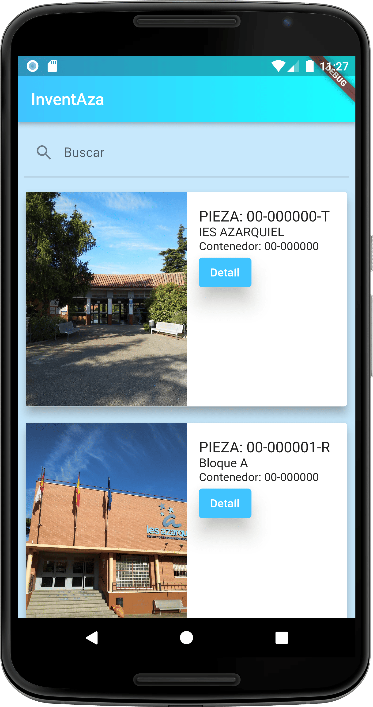
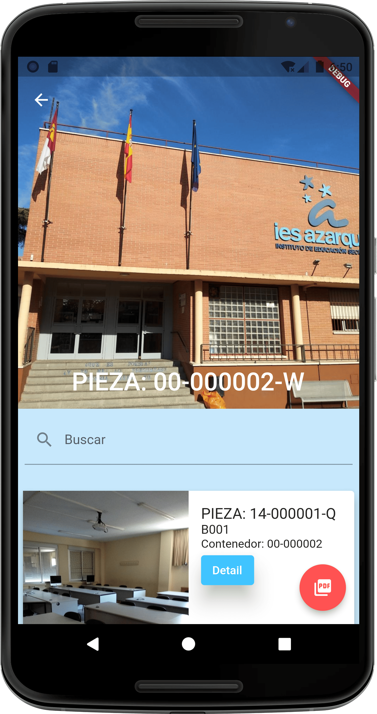
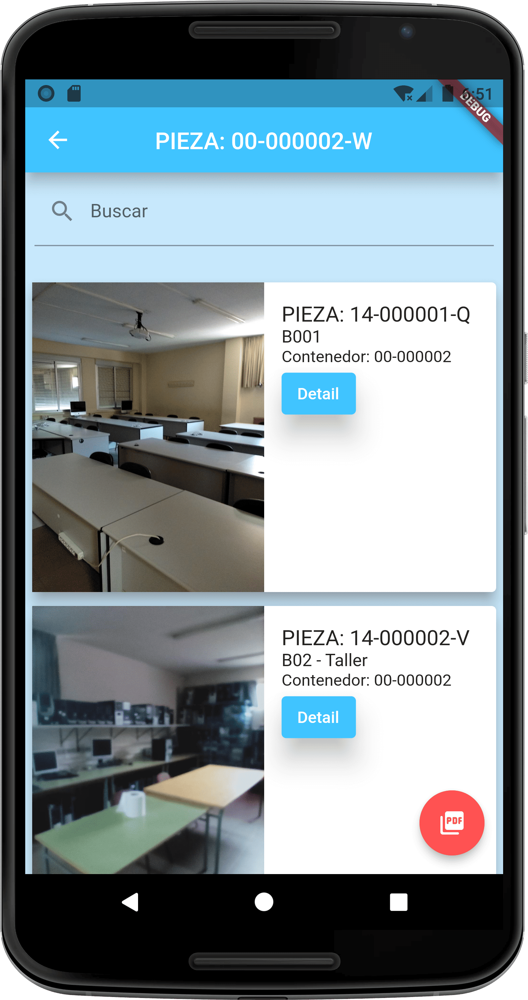
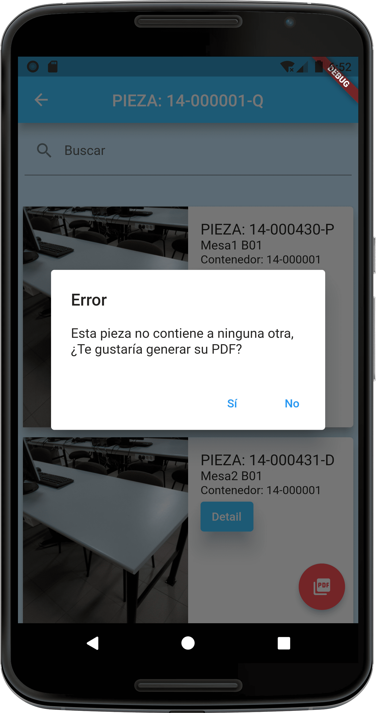
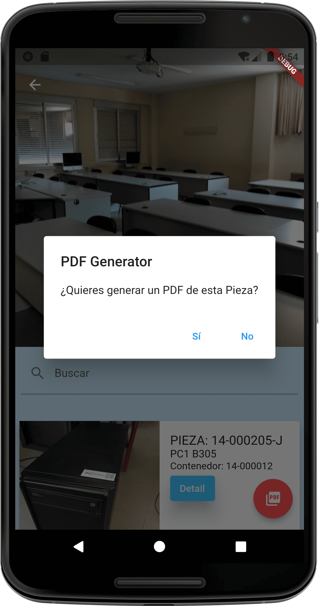
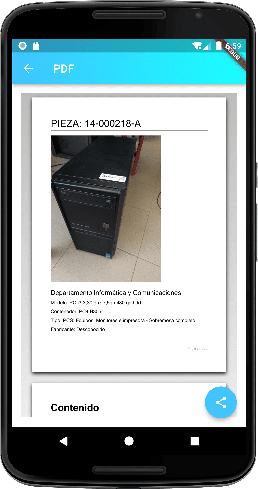

# 🏫 InventAza — School Inventory App (Flutter + Dart)


A mobile app to **locate and catalogue every item in a school**. Users browse the inventory hierarchically, from the school down to each object, and export any part of it to PDF.

> 🎓 **Academic project.** Final project (*Proyecto de Fin de Ciclo*) of the **Higher National Diploma in Multiplatform Application Development** (*CFGS Desarrollo de Aplicaciones Multiplataforma, DAM*) at **IES Azarquiel**, 2023.

---

## 📸 Screenshots

| Home | Piece contents | Collapsed header |
|:---:|:---:|:---:|
|  |  |  |
| <sub>The school and its buildings as root pieces</sub> | <sub>Header photo, search bar and contained pieces</sub> | <sub>The header collapses on scroll</sub> |

| Empty piece | Generate PDF | Generated PDF |
|:---:|:---:|:---:|
|  |  |  |
| <sub>Warning and option to export it</sub> | <sub>Confirmation before generating</sub> | <sub>Photo, data and contents</sub> |

---

## ✨ Features

- **Hierarchical navigation**: everything is a **piece** (*pieza*): the school, its buildings, the classrooms and every object inside them. Each piece can contain other pieces, so the inventory is browsed from top to bottom:
  ```
  IES Azarquiel
  └── Building
      └── Classroom
          ├── Cupboard
          ├── Desk
          ├── Whiteboard
          └── ...
  ```
- **Piece identification**: each piece has a code (for example `00-000000-T`), a photo and the **container** it is stored in.
- **Search** within the list of pieces.
- **Collapsible header** with the photo of the selected piece.
- **Empty piece warning**: if a piece contains nothing else, the app says so and offers to generate its PDF directly.
- **PDF export** of any piece, with its photo, its data (department, model, container, type and manufacturer) and the list of every piece it contains.
- **Share the PDF** from the built-in viewer.
- Custom splash screen with the school logo.

---

## 🧰 Tech Stack

| Layer | Technology |
|---|---|
| Framework | **Flutter** |
| Language | **Dart** |
| HTTP requests | [`http`](https://pub.dev/packages/http) |
| PDF generation and viewer | [`pdf`](https://pub.dev/packages/pdf) and [`printing`](https://pub.dev/packages/printing) |
| Splash screen | [`flutter_native_splash`](https://pub.dev/packages/flutter_native_splash) |
| Main platform | Android |

---

## 🏗️ Architecture

The app consumes a **REST API provided by the school**, which returns the pieces as JSON and serves their photos.

| Screen | Responsibility |
|---|---|
| `main.dart` | Entry point. Loads the root pieces (the school and its buildings) and shows them in a searchable list. |
| `piezaDetail.dart` | Shows the contents of a piece: collapsible `SliverAppBar` with its photo, search bar and child pieces. Opens the next level with **Detail**, or offers the PDF when the piece is empty. |
| `pdf.dart` | Builds the PDF of a piece and its contents, shows it in a `PdfPreview` and shares it with `Printing.sharePdf`. |

### Data model

Each `Pieza` holds its own code and owner, its **parent piece** (`codPiezaPadre`), which is what builds the hierarchy, and descriptive fields: model, type and subtype, manufacturer, container, department and registration date.

---

## 📁 Project Structure

```
pfc-inventaza/
├── lib/
│   ├── models/
│   │   └── Pieza.dart          # Piece data model
│   └── views/
│       ├── main.dart           # Entry point and root pieces list
│       ├── piezaDetail.dart    # Piece contents, search and PDF button
│       └── pdf.dart            # PDF generation, viewer and sharing
├── assets/                     # School logo (splash screen)
├── android/ · ios/ · web/ · windows/
├── screenshots/
└── pubspec.yaml
```

---

## 🚀 Running Locally

### Prerequisites
- [Flutter SDK](https://docs.flutter.dev/get-started/install)
- An emulator or an Android device

### Steps
1. Clone the repository:
   ```bash
   git clone https://github.com/ivangomezr/pfc-inventaza.git
   cd pfc-inventaza
   ```
2. Install the dependencies:
   ```bash
   flutter pub get
   ```
3. Run the app:
   ```bash
   flutter run -t lib/views/main.dart
   ```

> ⚠️ **About the data:** the pieces and their photos come from an API hosted by the school and built for this project. Its availability may change over time; if it stops responding, the app will not load any data. The screenshots show the app working.

---

## 🙋 Author

**Iván Gómez** — [@ivangomezr](https://github.com/ivangomezr)

Developed as the final project of the DAM programme at IES Azarquiel. This repository reflects the original state of the project in 2023.
