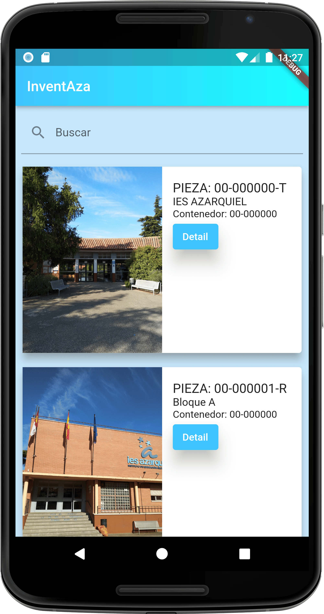
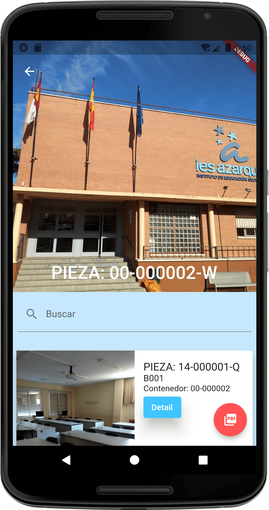
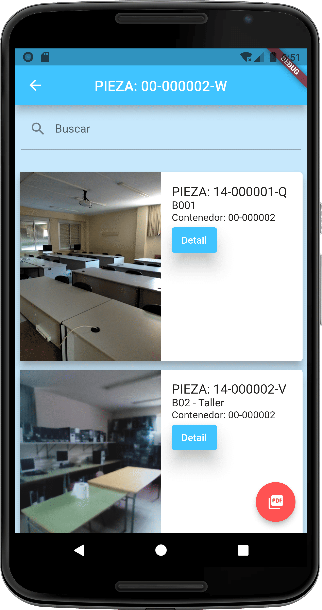
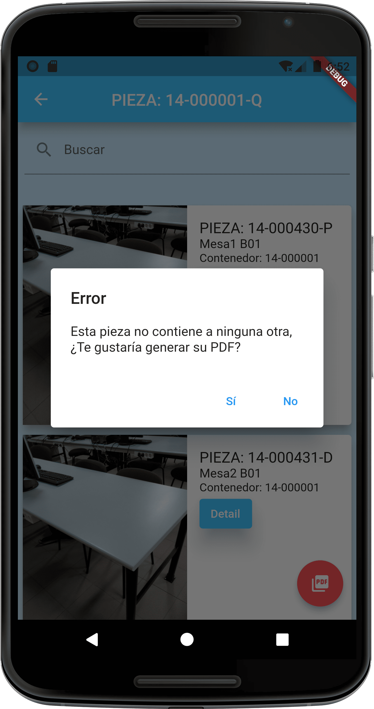
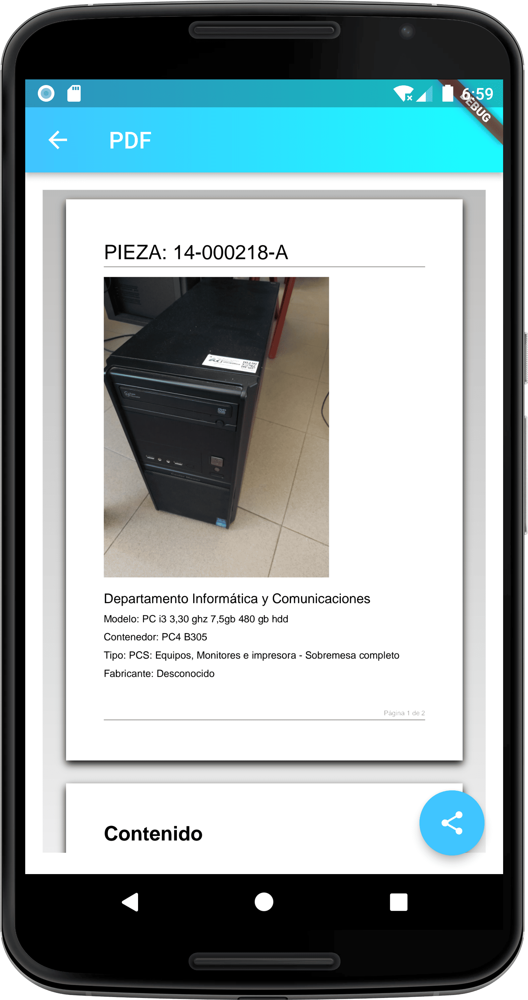

# 🏫 InventAza

Aplicación móvil para **localizar y catalogar todos los objetos de un centro educativo**, navegando por ellos de forma jerárquica y exportando el inventario a PDF.


---

## 📋 Descripción

Proyecto de fin de ciclo del **CFGS de Desarrollo de Aplicaciones Multiplataforma (DAM)** en el **IES Azarquiel**, desarrollado en 2023.

El objetivo es tener localizado cada objeto dentro del instituto. Todo es una **Pieza**: el propio centro, los bloques, las aulas y cualquier objeto que haya dentro de ellas. Cada pieza puede contener otras piezas, lo que permite recorrer el inventario de arriba a abajo:

```
IES Azarquiel
└── Bloque
    └── Aula
        ├── Armario
        ├── Mesa
        ├── Pizarra
        └── ...
```

Cada pieza se identifica con un código (por ejemplo `00-000000-T`), tiene su foto y muestra el **contenedor** en el que está.

## ✨ Funcionalidades

- **Navegación jerárquica**: se empieza por el instituto y, con el botón **Detail**, se abre el contenido de cada pieza (bloques, aulas, objetos...), y así sucesivamente
- **Búsqueda** dentro del listado de piezas
- **Cabecera con foto** de la pieza seleccionada, que se recoge al desplazar la lista
- **Aviso en piezas sin contenido**: si una pieza no contiene ninguna otra, la app lo indica y ofrece generar directamente su PDF
- **Generación de PDF** de cualquier pieza, con su foto, sus datos (departamento, modelo, contenedor, tipo y fabricante) y el listado de todas las piezas que contiene
- **Compartir el PDF** desde el propio visor de la app

## 🛠️ Stack técnico

| Capa | Tecnología |
|---|---|
| Framework | [Flutter](https://flutter.dev) |
| Lenguaje | Dart |
| Peticiones a la API | paquete [`http`](https://pub.dev/packages/http) |
| Generación y visor de PDF | paquetes [`pdf`](https://pub.dev/packages/pdf) y [`printing`](https://pub.dev/packages/printing) |
| Plataforma principal | Android |

## 🗂️ Estructura

```
lib/
├── models/
│   └── Pieza.dart          # Modelo de datos de una pieza
└── views/
    ├── main.dart           # Punto de entrada y listado inicial de piezas
    ├── piezaDetail.dart    # Contenido de una pieza: piezas hijas, búsqueda y botón de PDF
    └── pdf.dart            # Visor, generación y envío del PDF
```

## 🚀 Puesta en marcha

Requisitos: [Flutter SDK](https://docs.flutter.dev/get-started/install) instalado.

```bash
git clone https://github.com/ivangomezr/pfc-inventaza.git
cd pfc-inventaza
flutter pub get
flutter run -t lib/views/main.dart
```

> ⚠️ **Nota sobre los datos**: la aplicación obtiene las piezas y sus fotos de una API del propio centro educativo, pensada para este proyecto. Al ser un servidor del instituto, su disponibilidad puede cambiar con el tiempo, y si deja de responder la app no cargará datos. Las capturas muestran su funcionamiento.

## 📱 Capturas

|                                                    Inicio                                                     |                                                  Contenido de una pieza                                                   |                                                      Piezas contenidas                                                       |
|:-------------------------------------------------------------------------------------------------------------:|:-------------------------------------------------------------------------------------------------------------------------:|:----------------------------------------------------------------------------------------------------------------------------:|
| <br><sub>Instituto y bloques como piezas raíz</sub> | <br><sub>Foto en cabecera, buscador y piezas que contiene</sub> | <br><sub>Cabecera recogida al desplazar (B001, B02 - Taller)</sub> |

|                                            Pieza sin contenido                                            |                                              Generar PDF                                               |                                                  PDF generado                                                  |
|:---------------------------------------------------------------------------------------------------------:|:------------------------------------------------------------------------------------------------------:|:--------------------------------------------------------------------------------------------------------------:|
| <br><sub>Aviso y opción de generar su PDF</sub> | <br><sub>Confirmación antes de generar</sub> | <br><sub>Resultado con foto, datos y contenido</sub> |

## 📄 Contexto

Proyecto académico publicado como muestra de mi trabajo durante el ciclo formativo, por lo que refleja el estado original del proyecto en 2023.

---

Desarrollado por [Iván Gómez](https://github.com/ivangomezr)